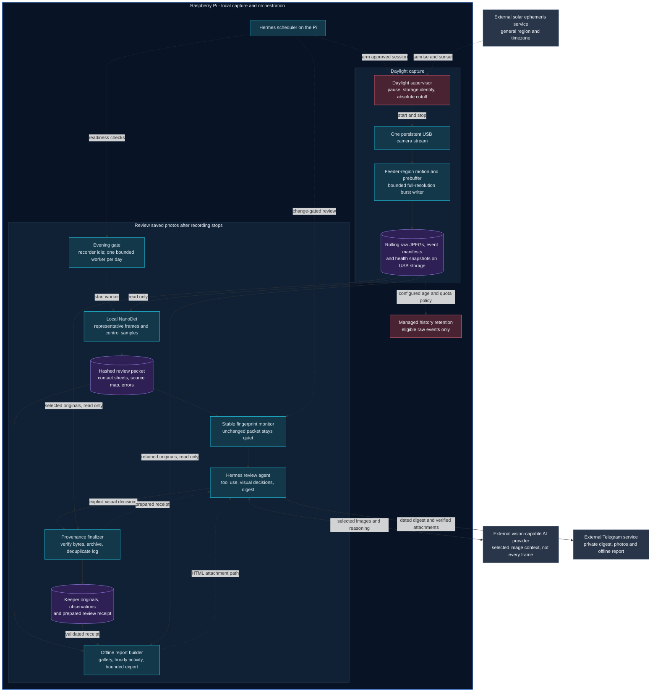
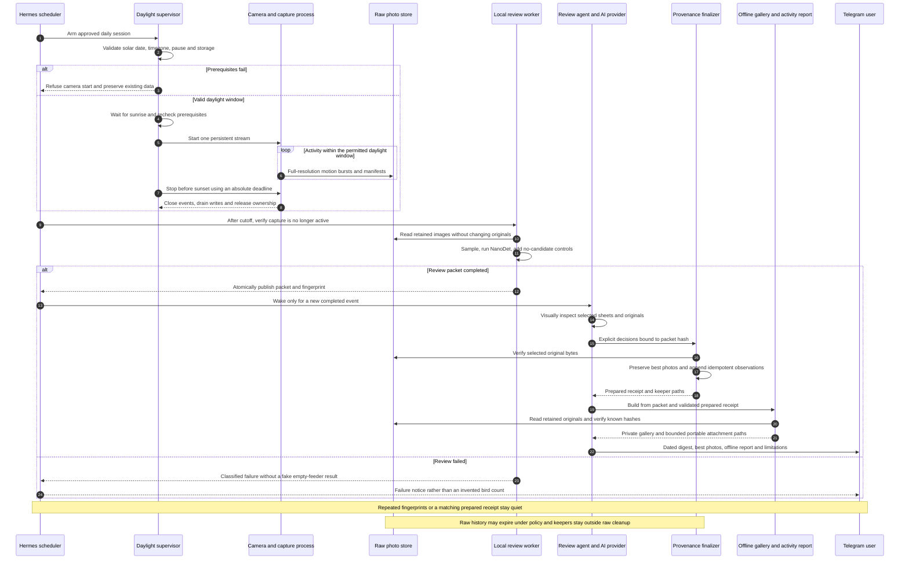

# Architecture and how BirdWatcherPi works

## Scope and implementation boundary

This document describes both the **repository's capture/optional-analysis components** and the **approved deployed workflow** around them. The goal is a collection of good bird photographs, not an exhaustive visitor census.

The core CLI is in this repository. Daylight supervision, the evening packet collector, explicit review finalization, and Telegram automation are currently **private operational helpers outside the checkout**. Their presence in this diagram does not mean a fresh clone installs or enables them. The repository now includes the separately tested storage-pressure fix used by the deployed recorder; private runtime configuration and orchestration remain distinct. Capture and review use separate, non-editable runtime environments; reviewing pictures does not replace the running recorder.

No deployment location, device identifier, personal path, credential, real photograph, or private configuration is included here.

## 1. System diagram

Solid arrows show image/result flow; dotted arrows show scheduling, control, or policy. The configured AI provider and Telegram are outside the Pi's local-processing boundary.

Editable source: [ARCHITECTURE.mmd](ARCHITECTURE.mmd).

## 2. Daily lifecycle

Editable source: [DAILY_LIFECYCLE.mmd](DAILY_LIFECYCLE.mmd).

## 3. Step-by-step outline

### A. Arm safely; record only in daylight

The local scheduler arms an approved daily session. The supervisor validates the local calendar date, IANA timezone, solar window, manual pause, expected storage identity and available destination. It waits for sunrise, then rechecks prerequisites before starting. A separate absolute deadline stops capture conservatively before sunset; it is a clock/ephemeris guard, not a darkness sensor.

Missing or wrong storage, an unresolved daylight window, or a manual pause must refuse recording rather than silently choose another destination. A scheduled job is not proof that the camera is alive: check the real process plus a fresh health report and increasing frame receipts.

### B. Notice activity and preserve useful frames

One FFmpeg stream owns the USB camera. Downscaled images feed background-subtraction motion analysis in approved feeder regions. A bounded pre-trigger buffer retains original JPEG bytes around a trigger, and a separate bounded writer persists full-resolution photo bursts and event manifests.

Motion is only a trigger: feeder sway, lighting and other activity can produce events. Event segments and saved frames are not bird counts. Camera receipt timestamps are retained in UTC; daily review filters using the configured local timezone rather than assuming a UTC folder is a local calendar day.

### C. Keep rolling raw history separate from keepers

Raw captures and manifests live on the configured private photo volume. Storage code may reclaim only eligible managed history under configured age, quota and free-space rules. Protected/active events and unrecognized data are not casually deleted.

Selected keeper originals are copied into a separate private archive. Routine raw-history cleanup does not own that archive, review logs or unrelated backups. The review itself never suppresses a capture or deletes an original. The current deployed raw policy is 14 days / 40 GiB with a 2-GiB free-space reserve, distinct from the package example's 5-GiB quota. The approved ordinary-history expiry does not authorize deleting keeper archives or preserved backups.

### D. Prepare a bounded local review packet

After recording stops, a deterministic evening gate starts one bounded worker for the local day. The worker requires exclusive ownership of the existing capture-data lock and only reads source files.

The local NanoDet model examines representative saved frames. Candidate scores prioritize a shortlist; systematic no-candidate controls help reveal model misses. Results retain exact source-byte hashes, timestamps, regions, scores, failures and sampling scope. Contact sheets and a source-index map are published before the final packet becomes ready.

This is **sampled analysis**, not a guarantee that every image was inspected. A model returning no box means unknown, not an empty feeder. A decoder returning pixels is not proof of a corruption-free JPEG.

### E. Visually confirm selected observations

A stable fingerprint monitor wakes the Hermes review agent only for a new completed packet. Repeated unchanged checks do not continually invoke the language model.

The agent uses a configured vision-capable AI provider to inspect selected contact sheets and a small number of originals or original-resolution crops. It chooses useful, sharp, well-exposed bird photographs with variety, while keeping uncertain cases separate. Current automatic budgets are at most six contact sheets / 120 shortlisted frames, up to three full-resolution originals/crops, and at most three keeper attachments; the finalizer itself permits at most five. These are sampled-review limits, not exhaustive coverage or implemented automatic quality ranking. A specialized species classifier is not part of the current core; any visual species suggestion remains distinct from a validated species-model result.

**Local-first does not mean nothing leaves the Pi.** Capture, raw storage and NanoDet inference run locally. Selected review images/context are supplied to the configured AI provider, and selected best photos are delivered privately through Telegram. The workflow does not send every camera frame to a cloud model or publish photos to a website.

### F. Finalize evidence before composing the report

The finalizer accepts explicit visual decisions tied to the packet hash. It validates selected indices, source containment, original-byte hashes, canonical UTC/local timestamps and output/source separation. It preserves the selected keeper bytes and appends provenance-backed observations idempotently.

CSV validation checks complete records before any append, not just observation IDs. Stable identities prevent different source images from collapsing into one observation, while verified legacy evidence avoids relogging the same frame. Output publication and lock handling protect original files, including against hard-link aliases.

The receipt says **prepared**, not delivered. A local receipt proves finalization, not that Telegram accepted a message.

### G. Browse saved photographs and activity

The public offline-report components normalize all inventory/model-result metadata, validate packet-matched visual confirmations, and render an on-device gallery plus a bounded portable HTML attachment. The gallery is independent of the keeper limit and distinguishes candidates, confirmed photos, unknown/no-box samples, unsampled frames and unavailable sources.

Hourly counts and UTC-gap photo groups are activity proxies, not unique birds, actual visits or measured feeding duration. Coverage uses coarse session bounds rather than a continuous-frame claim. Local original links require retained files on the Pi; the portable attachment embeds only bounded selected bytes and explicitly labels omissions. It is a private file, not a hosted website. See [DAILY_REPORT.md](DAILY_REPORT.md).

### H. Deliver one honest digest

Hermes delivers the dated digest, keeper attachments and bounded offline-report file to the private chat. It includes representative confirmed times, review/sample scope, important capture errors and uncertainty. Confirmed photo observations are not a count of distinct birds or visits.

The prepared receipt and packet fingerprint suppress duplicate reports. Classified review failures produce failure handling rather than fabricated photos or a false no-birds conclusion. Delivery status is checked separately from receipt preparation; ambiguous delivery must not be blindly replayed.

## 4. Component map

### Repository components

- [cli.py](../src/birdwatcher/cli.py): camera diagnostics, snapshots, capture, status/events, optional shadow-analysis entry point.
- [camera.py](../src/birdwatcher/camera.py): persistent camera access, frame acquisition and ownership.
- [motion.py](../src/birdwatcher/motion.py): approved-region background-subtraction triggers.
- [events.py](../src/birdwatcher/events.py): buffered event and burst lifecycle.
- [runner.py](../src/birdwatcher/runner.py): bounded producer/writer handoff and health reporting.
- [storage.py](../src/birdwatcher/storage.py): manifests, crash recovery, managed retention and quotas.
- [bird_detector.py](../src/birdwatcher/bird_detector.py): pinned local NanoDet candidates and geometry/provenance.
- [analysis.py](../src/birdwatcher/analysis.py): optional durable shadow worker; this is separate from the deployed evening-packet orchestration.

- [report_data.py](../src/birdwatcher/report_data.py): read-only packet/receipt normalization, hourly sampled activity and explicit coverage/uncertainty.
- [report_view.py](../src/birdwatcher/report_view.py): offline responsive gallery, filters, activity chart and image inspector.
- [report_export.py](../src/birdwatcher/report_export.py): private bounded source-safe on-device and portable artifact generation.

### Private deployment helpers — names only, not installed by this repository

- `run-daylight-capture.py`: daylight/storage supervision and finite capture deadline.
- `arm-sunrise-session.py`: idempotent daily arming without blocking the scheduler for hours.
- `review_schedule.py`: evening gate, bounded detached worker and stable completion monitor.
- `daily_review.py`: sampled local inference, candidates/controls, contact sheets and final review packet.
- `finalize_daily_review.py`: explicit confirmation, verified keeper copies, complete observation log and prepared receipt.
- A compact scheduled review skill and private instructions drive the AI-assisted digest; the Hermes gateway handles actual Telegram delivery.

## 5. What this does not guarantee

- Complete bird-arrival coverage, unique-individual counts, or absence from unreviewed images.
- A calibrated detector score or validated species-classifier accuracy.
- Zero camera/storage failures, unlimited retention, or every physical power-loss outcome.
- Automatic installation of private operational helpers, boot services or credentials from a fresh clone.
- A delivered message merely because a review receipt exists.

For core capture procedures, see [SETUP.md](SETUP.md) and [OPERATIONS.md](OPERATIONS.md). For detector limits, see [SHADOW_ANALYSIS.md](SHADOW_ANALYSIS.md) and [MODEL_DECISION.md](MODEL_DECISION.md). The detailed future target remains in [SPECIFICATION.md](SPECIFICATION.md).
