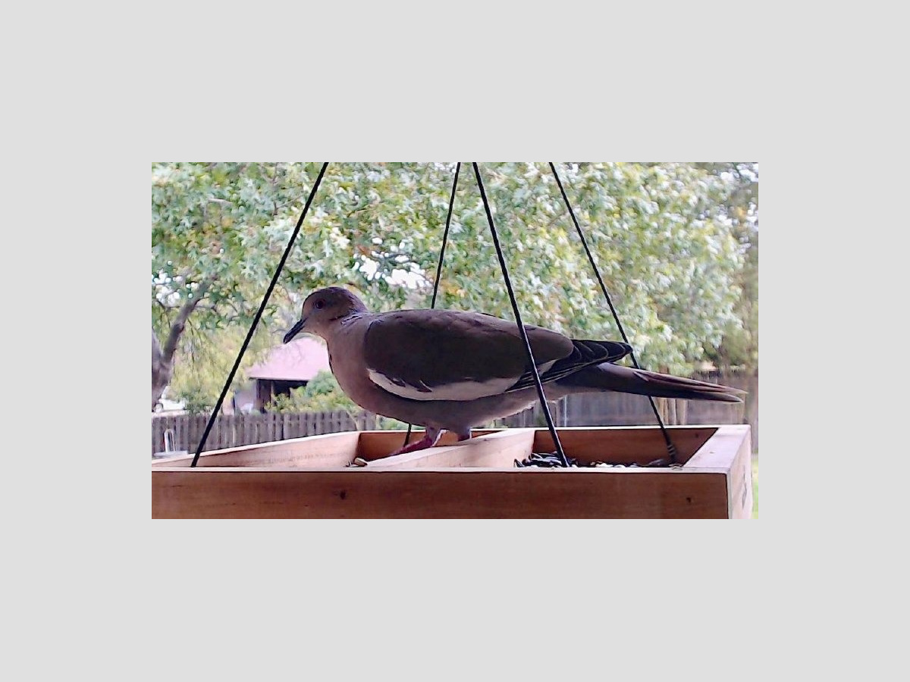
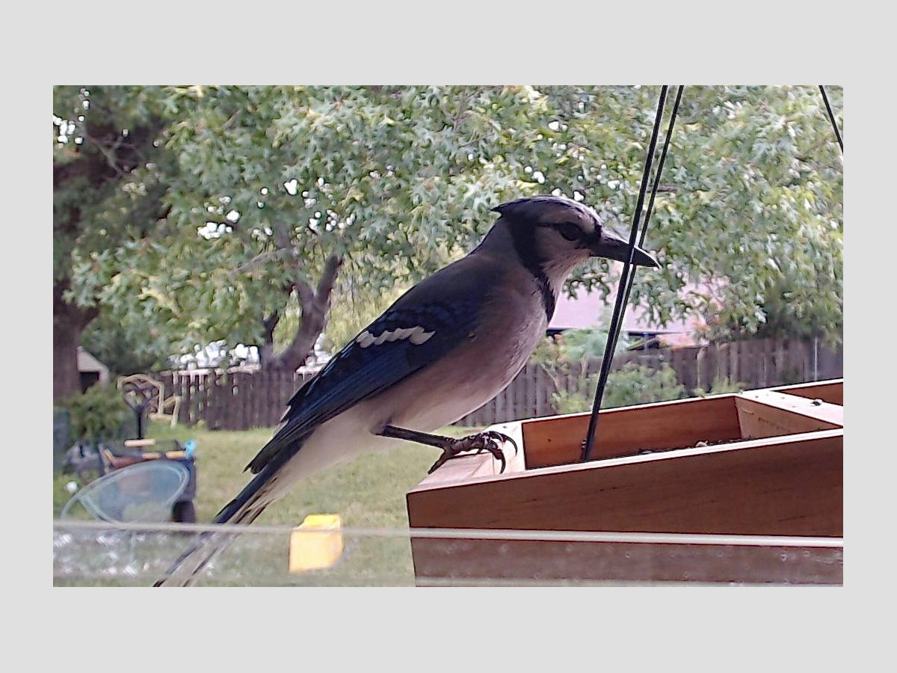
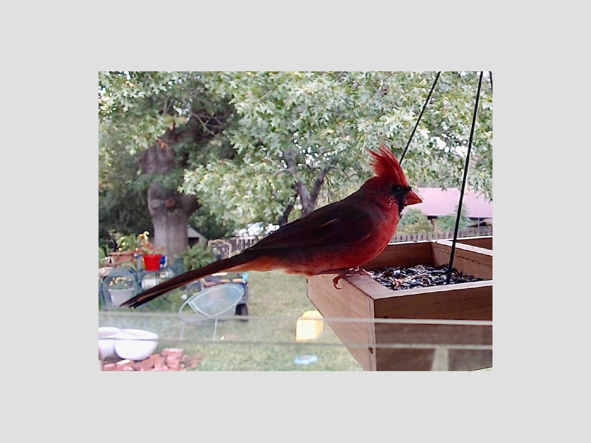
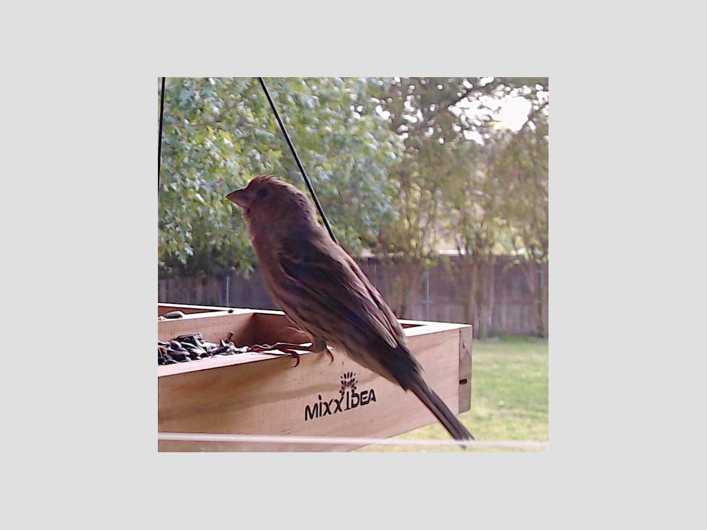
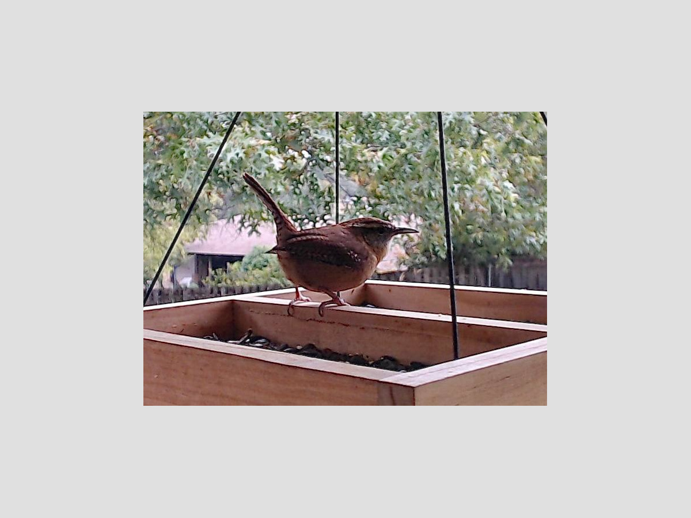
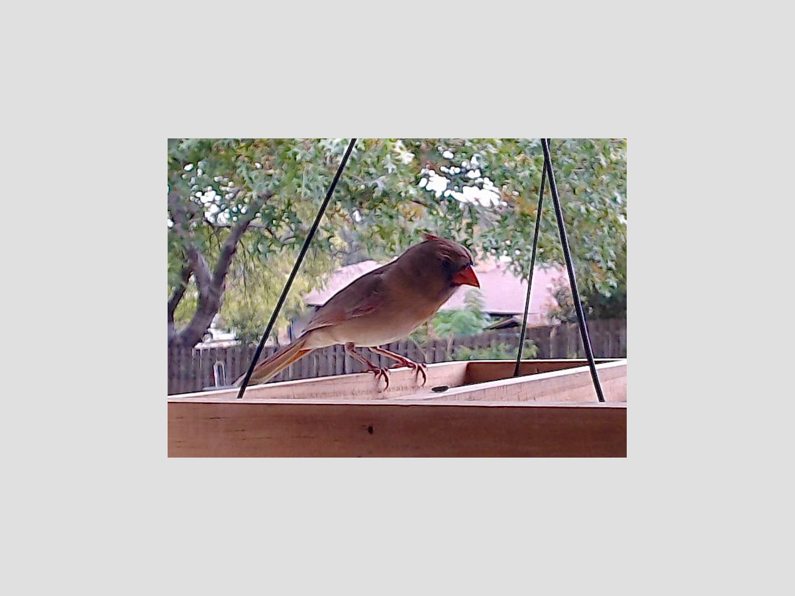
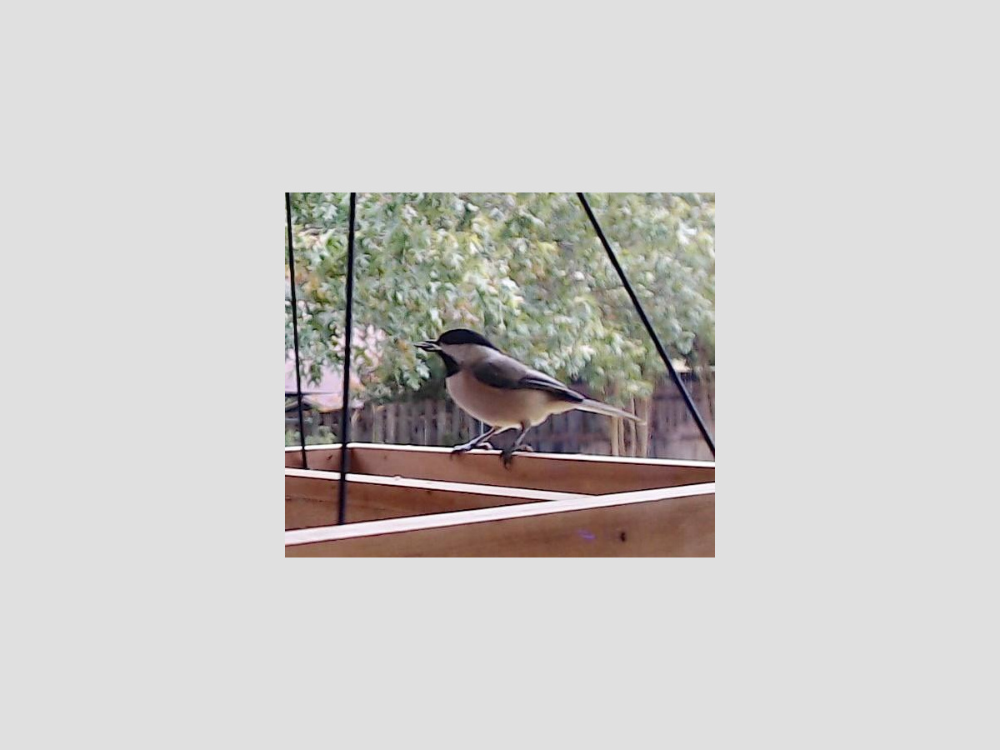
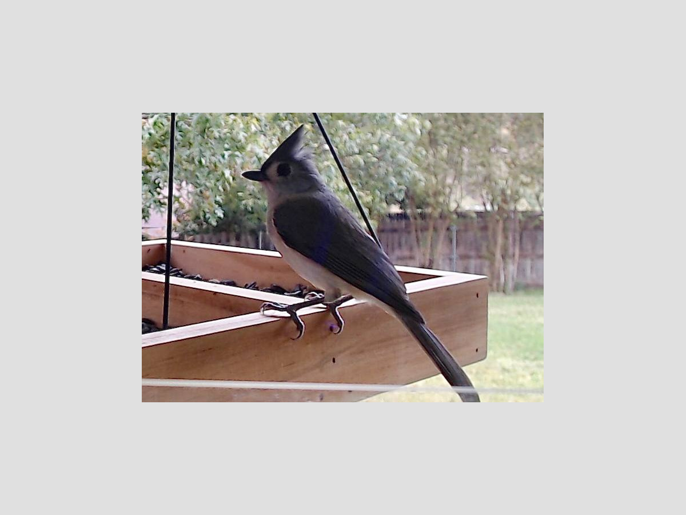

# Bird photo gallery

Eight photographs supplied by the owner. The bird IDs are visual identifications, not results from a validated species classifier.

The photographs are re-encoded without source metadata. They are examples, not evidence of identification accuracy.

## White-winged Dove

## Blue Jay

## Northern Cardinal (male)

## House Finch

## Carolina Wren

## Northern Cardinal (female)

## Carolina Chickadee

## Tufted Titmouse

