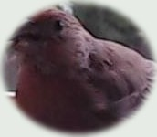
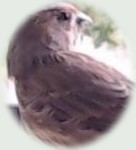
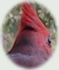

# Example bird photographs

These small bird-detail crops were supplied by the owner from a personal collage. They were tightly cropped and re-encoded without EXIF or GPS metadata; the surrounding margins were masked for privacy. They are illustrative photos, not motion-box calibration examples or evidence of model accuracy.

