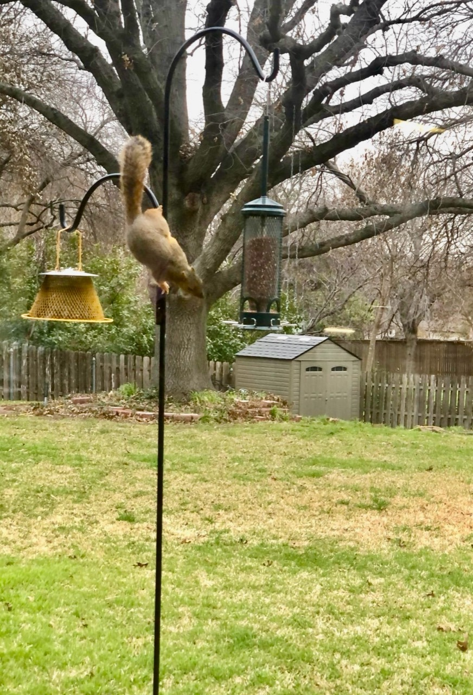
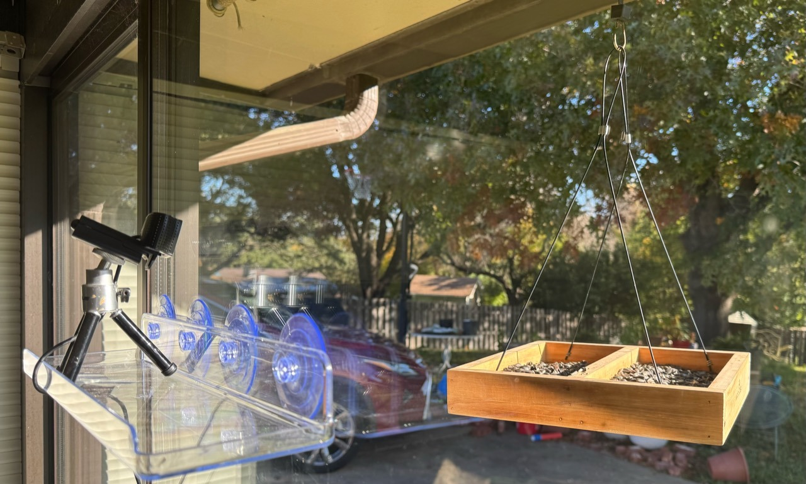

# Bird feeder lessons

The feeder is part of the camera system. A good place to offer seed is not necessarily a good setup for motion-triggered photographs. These are the lessons from three versions of our feeder setup.

## 1. Ground pole with a hanging feeder

We started with a ground-mounted pole and a hanging squirrel-proof bird feeder.

The squirrel found its way onto the pole. The photograph shows access to the support, not proof that it defeated the feeder's seed-access mechanism. A squirrel-proof feeder and a squirrel-resistant installation are two different things.

**Lesson:** consider the whole route to the feeder, including its pole and nearby climbing or jumping opportunities.

## 2. Hanging from the roof overhang

The current arrangement has a tray feeder hanging outside the window from the roof overhang, with the camera inside looking through the glass.

This brings the feeder into the camera's view, but the tray swings too much. Its movement triggers motion detection even when the movement is from the feeder rather than a bird. Suspension cables also pass through the photographs.

Shooting through glass introduces another issue: indoor reflections can look like activity or obscure the birds. We have already had to discard a group of photographs showing reflections of the interior.

**Lessons:**

- Keep the feeder and camera steady so feeder movement does not become the subject of motion detection.
- Keep support cables and bars out of the intended bird-photo area.
- Check the actual camera image for reflections as indoor and outdoor lighting changes.

## 3. Next experiment: a fixed pole from the overhang

The next setup will use a rigid pole extending down from the overhang, with mesh feeding trays mounted to it. The new trays are expected Saturday, November 28, 2026.

The goals are to reduce swinging, remove suspension cables from the bird-photo area, and position the trays for clear front or side views of visiting birds. Bird orientation is not guaranteed.

**Status: planned, not yet tested.** A rigid pole may still flex or twist, especially with trays offset to one side. We will judge the result from the camera view and real captures, not just how steady it looks by eye.

### What we will check

- Feeder movement in wind and when birds land.
- Whether the pole or tray brackets enter the photographs.
- Focus, framing, and visibility of birds' heads, bodies, and feet.
- Motion-triggered captures with and without birds present.
- Access for refilling, drainage, and cleaning.

The overhead attachment and pole retention need to suit the hanging orientation; a pole mount intended to carry weight from below should not be assumed suitable upside down.

## The working principle

We want motion to come from the birds, with a stable feeder and an unobstructed camera view. Each physical change needs a new check of framing, focus, reflections, and motion regions.

---

These photographs were supplied by the owner for this page and re-encoded without embedded location or other source metadata. The photographs still show the surroundings visible in the scene.

[Bird photo gallery](BIRD_GALLERY.md) | [Project README](../README.md)
