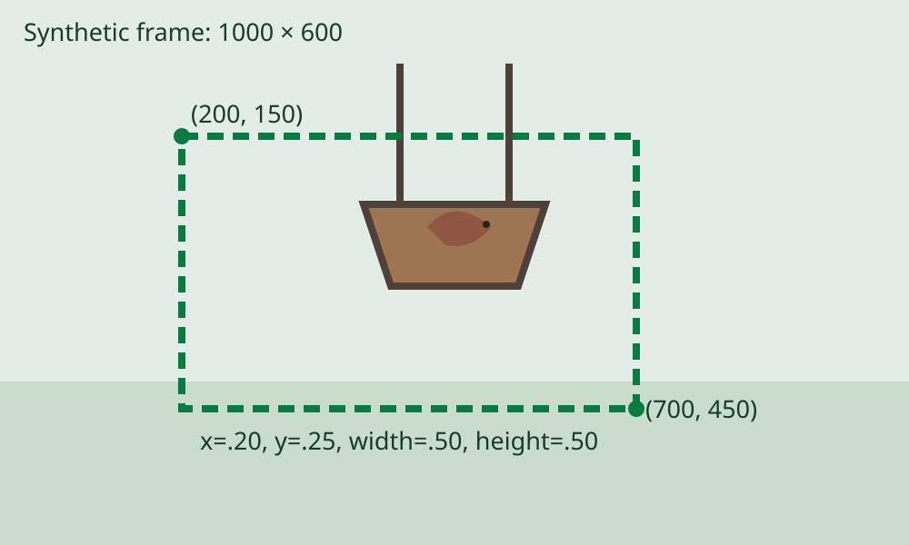

# Configuring motion boxes

Motion boxes are rectangles where changes can trigger capture; they are not bird detectors. The illustration is synthetic, not a camera image or a recommended setting.



Coordinates are fractions of the **whole image**: `x` and `y` are the top-left corner, `width` and `height` are the rectangle dimensions. The origin is top left; x increases rightward and y downward. For an image 1,000 × 600 pixels, a box from (200, 150) to (700, 450) gives x=0.20, y=0.25, width=0.50, height=0.50. Values must be within 0–1 and the right and bottom edges must not exceed 1. The detector uses these fractions after resizing the frame.

For example, replace the existing `near_feeder` block in your **private copy** of `config/config.example.toml` with the following; do not append a duplicate or edit the tracked example:

```toml
[[motion.regions]]
name = "near_feeder"
x = 0.20
y = 0.25
width = 0.50
height = 0.50
enabled = true
```

The tracked example has both regions disabled intentionally. Each enabled region needs a unique name. The example above is illustrative; measure your own camera view, covering the feeder and likely approach paths without including unnecessary moving vegetation. Move or resize boxes if the camera or feeder moves. Keep configuration and calibration photographs private. The public package does not provide an annotated calibration-preview command; review a sample with your own image tool before enabling capture. See [SETUP.md](SETUP.md) for copying the config and running a bounded test.

`motion.min_area` is the fraction of a region that must change, and `motion.persistence` is the number of consecutive analyzed frames meeting that threshold; these settings are global, not per-region. Swaying branches and lighting can trigger change, and motionless birds can be missed. Suppression and warm-up can also miss activity. Tune against real footage; do not treat a trigger as confirmation of a bird.
